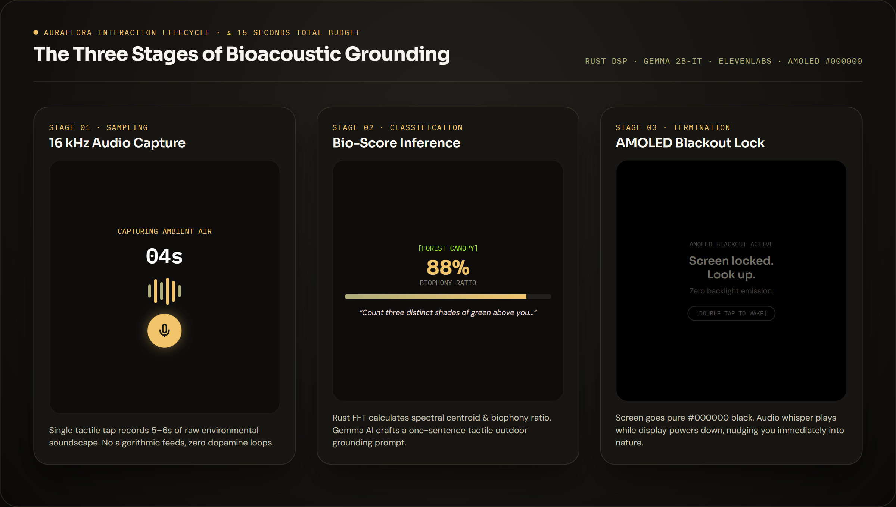
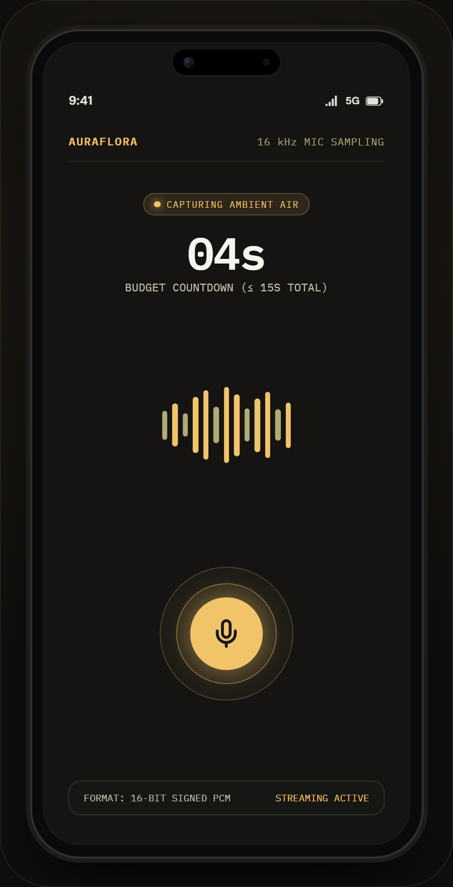
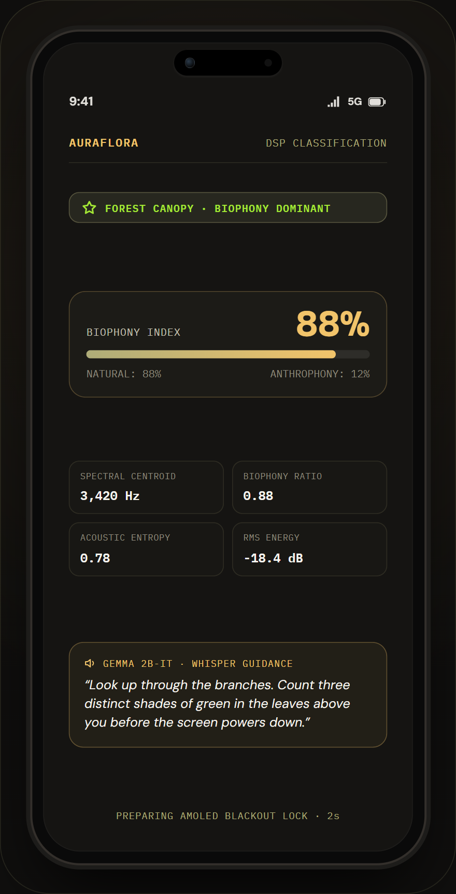
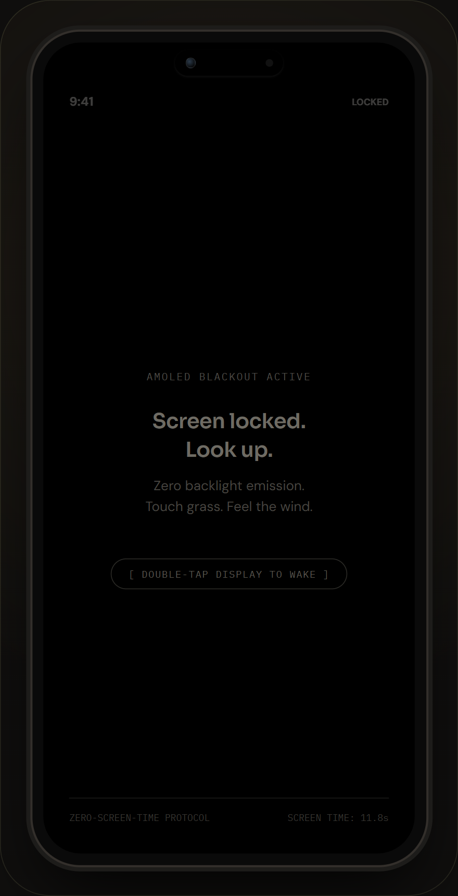
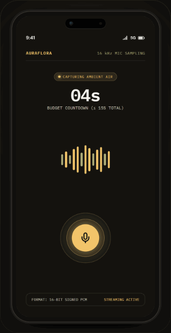

<div align="center">
  <h1>🌿 AuraFlora</h1>
  <p><strong>BioAcoustic Grounding Companion</strong></p>
  <p><em>Hacktoberfest 2026 · "Touch Grass" Challenge</em></p>
  <p>
    
    
    
    
    
    
    
  </p>
</div>

---

## What is AuraFlora?

AuraFlora is an **anti-screen mobile application** that gets you off your phone and into the physical world in under 15 seconds.

1. **Press** — Tap the single record button.
2. **Listen** — The app captures 5–10 seconds of your ambient environment through the microphone.
3. **Ground** — The Rust backend analyzes the soundscape (biophony vs anthrophony) and generates a tactile outdoor grounding instruction via Gemma AI.
4. **Blackout** — ElevenLabs whispers the instruction to you, the screen goes pure `#000000`, and you go outside.

---

## Application Interface & Interaction Flow

<div align="center">
  
</div>

### Core Stages (≤ 15-Second Screen Time Protocol)

| 1. Ambient Audio Capture | 2. Bio-Score Classification | 3. AMOLED Blackout Lock |
| :---: | :---: | :---: |
|  |  |  |
| **Stage 01: Capture**<br>• Real 16 kHz Mono PCM audio recording<br>• Dynamic audio waveform & pulse animation<br>• 5–6s session countdown (≤15s total budget) | **Stage 02: Classification**<br>• Real-time Biophony vs. Anthrophony ratio (88%)<br>• Spectral centroid, entropy & RMS features<br>• 1-sentence outdoor grounding whisper (Gemma AI) | **Stage 03: Blackout**<br>• Pure `#000000` AMOLED display shutoff<br>• Zero backlight photon emission<br>• Terminal lock (double-tap to wake) |

<br/>

<div align="center">
  <h3>Interactive Demo Recording</h3>
  <p><em>Live interaction loop: 16 kHz capture → DSP biophony classification → AMOLED blackout detox</em></p>
  
</div>

---

## Architecture

```
┌─────────────────────────────────────────────────────────────┐
│  React 19 + Vite PWA (Web Audio API / Mobile Simulator)     │
│  ┌──────────────┐  ┌─────────────┐  ┌───────────────────┐  │
│  │ MobileSim    │  │ BlackoutScr │  │ SoundEngine       │  │
│  │ PulseListener│  │ #000000     │  │ (Web Audio API)   │  │
│  └──────┬───────┘  └─────────────┘  └─────────┬─────────┘  │
│         │ record (16kHz PCM Base64)            │            │
│         └─────────────────────────────────────►│            │
│                                    POST /api/v1/ground      │
└────────────────────────────────────────────────┼────────────┘
                                                 │ base64 WAV
                                                 ▼
┌─────────────────────────────────────────────────────────────┐
│  Rust Backend (Axum + Tokio)                                │
│                                                             │
│  ┌─────────────────┐   ┌──────────────┐   ┌─────────────┐  │
│  │ DSP / rustfft   │   │ TabPFN svc   │   │ Gemma svc   │  │
│  │ spectral centrd │──►│ biophony vs  │──►│ 1-sentence  │  │
│  │ biophony ratio  │   │ anthrophony  │   │ prompt gen  │  │
│  │ entropy / RMS   │   └──────────────┘   └──────┬──────┘  │
│  └─────────────────┘                            │          │
│                                                 ▼          │
│                                        ┌─────────────────┐ │
│                                        │ ElevenLabs TTS  │ │
│                                        │ whisper voice   │ │
│                                        │ → /audio/{id}   │ │
│                                        └─────────────────┘ │
└─────────────────────────────────────────────────────────────┘
```

---

## Quick Start

### Backend

```bash
# Prerequisites: Rust 1.75+
cd backend
cp ../.env.sample .env  # Fill in your API keys
cargo run
# → Listening on 0.0.0.0:8080

# Test health
curl http://localhost:8080/health
# → {"status":"ok","version":"0.1.0","service":"aura-flora-backend"}
```

### Frontend (React + Vite + PWA)

```bash
# Prerequisites: Node.js 18+
cd frontend
npm install
npm run dev
# → Listening on http://localhost:5173
```

---

## Environment Variables

See [`.env.sample`](.env.sample) for all required variables.

| Variable | Required | Description |
|---|---|---|
| `GEMMA_API_KEY` | ✅ | Google AI Studio key for Gemma 2B-IT |
| `ELEVENLABS_API_KEY` | ✅ | ElevenLabs key for TTS synthesis |
| `ELEVENLABS_VOICE_ID` | ✅ | Voice ID (calm, whisper-style) |
| `TABPFN_API_KEY` | ⬜ | TabPFN classification (heuristic fallback if absent) |
| `PORT` | ⬜ | Server port (default: 8080) |

> **Local / Offline Mode**: If `GEMMA_API_KEY` or `ELEVENLABS_API_KEY` is absent, the backend serves curated biome-specific grounding instructions with clear provider transparency (`provider_status.elevenlabs_live: false`), and the client provides spoken whisper via local browser speech synthesis.

---

## Quality & Testing Gates

Run the verification suites locally before submitting changes:

### Backend (Rust)

```bash
cd backend
cargo fmt --check
cargo clippy --all-targets --all-features -- -D warnings
cargo test
```

### Frontend (React / Vite)

```bash
cd frontend
npm run lint       # oxlint
npm run typecheck  # tsc -b
npm test           # vitest run
npm run build      # production build
```

---

## Project Structure

```
aura-flora/
├── .agent/          # Agent rules, workflows, design constraints
├── .tasks/          # Implementation task checklists (01–05)
├── .github/         # CI workflows and issue/PR templates
├── backend/         # Rust (Axum) — DSP, AI orchestration, HTTP
│   ├── src/
│   │   ├── dsp/     # FFT, spectral centroid, biophony ratio (spawn_blocking)
│   │   ├── services/# Gemma, TabPFN, ElevenLabs clients
│   │   ├── handlers/# Axum request handlers & AppError mapping
│   │   └── lib.rs   # Router builder and application state
│   ├── tests/       # End-to-end integration tests
│   └── Dockerfile   # Multi-stage → distroless
└── frontend/        # React 19 + TypeScript + Vite + PWA
    ├── src/
    │   ├── components/  # Mobile simulator, Audio visualizers, Lab
    │   ├── hooks/       # useGroundingSession state machine
    │   ├── services/    # SoundEngine (Web Audio API), ApiService
    │   ├── constants/   # Audio presets & design tokens
    │   └── types.ts     # Acoustic telemetry & classification types
    ├── tests/           # Vitest unit test suites
    └── public/          # PWA manifests, icons, audio assets
```

---

## Zero-Screen-Time Laws

- ⏱️ **15-second rule** — entire interaction must complete in ≤ 15s
- 🚫 **No streaks, no badges, no notifications, no social features**
- ⬛ **Blackout is terminal** — exit only by double-tap
- 🎤 **One button** — the entire UI is a single record button

---

## Open Source & Community

- [Contributing Guidelines](CONTRIBUTING.md) — Setup, PR process, and code quality expectations
- [Security Policy](SECURITY.md) — Audio data privacy and vulnerability reporting
- [Code of Conduct](CODE_OF_CONDUCT.md) — Community standards (Contributor Covenant 2.1)
- [Agent & Contributor Guide](AGENTS.md) — Technical invariants, contracts, and guardrails
- [Changelog](CHANGELOG.md) — Release notes and version history

---

## Deployment (Render & Docker)

```bash
# Build Docker image
docker build -t aura-flora-backend ./backend

# Run with docker-compose
docker-compose up --build
```

See [`render.yaml`](render.yaml) for full Render Web Services config.

---

## License

MIT — see [LICENSE](LICENSE)

---

<div align="center">
  <sub>Built for Hacktoberfest 2026 · Touch Grass Challenge · Go outside. 🌱</sub>
</div>
